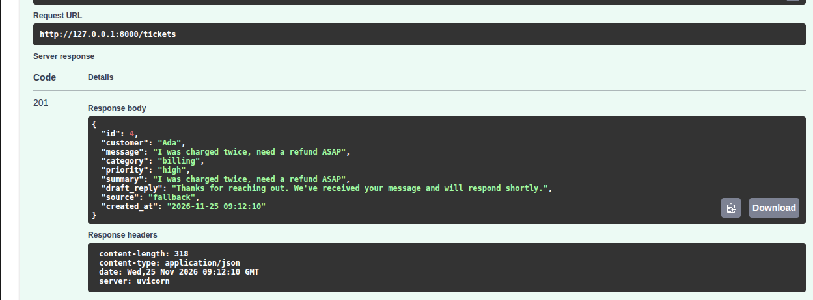

# AI Support Ticket Triage API

A small backend service that uses an LLM to triage customer support tickets:
it categorizes each message, assigns a priority, writes a one-line summary,
and drafts a reply. Everything is stored in SQLite and exposed through a REST API.

**Stack:** Python, FastAPI, SQLite, Anthropic API, pytest

## Why I built it
To practice the core of AI engineering work: integrating an LLM into a real
workflow, validating its output, handling failures gracefully, and exposing
the result through a tested API.

## How it works
1. `POST /tickets` receives a customer message.
2. `triage.py` asks the LLM for structured JSON (category, priority, summary, draft reply).
3. The output is validated. Invalid values are corrected, and if the LLM call fails
   or no API key is set, a keyword-based fallback runs so the API never breaks.
4. The ticket and triage result are saved to SQLite and returned.

## Run it
```bash
pip install -r requirements.txt
export ANTHROPIC_API_KEY=your_key   # optional; without it the fallback is used
uvicorn main:app --reload
```
Open http://127.0.0.1:8000/docs for interactive API docs.



## Endpoints
| Method | Path | Description |
|---|---|---|
| POST | `/tickets` | Create and triage a ticket |
| GET | `/tickets` | List tickets (`?category=` and `?priority=` filters) |
| GET | `/tickets/{id}` | Get one ticket |

Example:
```bash
curl -X POST localhost:8000/tickets -H "Content-Type: application/json" \
  -d '{"customer": "Ada", "message": "I was charged twice, need a refund ASAP"}'
```

## Tests
```bash
pytest
```
Tests run offline using the fallback path.

## Possible next steps
- Add a Telegram or WhatsApp webhook as an input channel
- Evaluate LLM triage accuracy against a labeled sample set
- Add authentication and Docker
